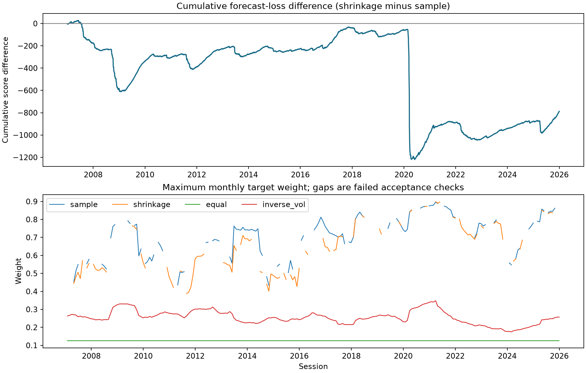

# Correlation Shrinkage and Portfolio Risk

**Does softening estimated correlations improve next-day risk forecasts?**

This study compares sample second moments with analytical correlation shrinkage that preserves individual variances. It combines controlled known-covariance simulations with a fixed eight-product historical case study.

**Historical finding:** shrinkage had lower observed mean loss across **4,780 paired forecasts in 2007–2025**, but both registered uncertainty intervals span zero. The improvement question remains **inconclusive**. Portfolio construction is an **incomplete secondary extension**, with 94 of 228 monthly weight pairs passing all numerical checks.

[Read the research report](RESEARCH-REPORT.md) · [Historical results](docs/results/historical/REPORT.md) · [Synthetic results](docs/results/synthetic/REPORT.md) · [Reproduce and verify](docs/REPRODUCTION.md)



The upper panel is cumulative forecast loss, not a portfolio equity curve. Gaps in target-weight diagnostics retain failed acceptance checks.

## Results

| Historical quantity | Recorded result |
|---|---:|
| Complete paired forecast targets | 4,780 / 4,780 |
| Mean loss difference, shrinkage minus sample | −0.164760 |
| Primary nominal 95% HAC interval | [−0.637263, +0.307743] |
| Bootstrap nominal 95% sensitivity interval | [−0.517470, +0.322224] |
| Invalid primary covariance forecasts | 0 |
| Accepted monthly portfolio pairs | 94 / 228 |

Lower loss is better. An interval spanning zero is inconclusive evidence, not equivalence. Scores are not investment returns.

In simulations, shrinkage lowered average expected matrix-score regret in all 18 fixed-covariance cells. Each cell uses 500 independent training samples; an additional 400 covariance-change paths produce 504,000 paired targets. These are controlled mechanism studies, not proof of historical performance.

Two limitations remain central:

- **Uncertainty calibration:** nominal 95% intervals covered the known mean only 88.1% of the time for HAC and 89.0% for bootstrap in the long-dependence diagnostic. The historical confidence levels require qualification.
- **Portfolio numerics:** 80 sample and 88 shrinkage monthly solutions failed the registered acceptance checks. The portfolio component cannot support a completed investment-performance comparison. Failures and settings were preserved rather than relaxed to produce a win.

## Design

The ordered universe is **SPY, EFA, EEM, IEF, TLT, LQD, GLD, VNQ**: equity regions, Treasury maturities, corporate credit, gold and listed real estate. There are 5,283 accepted common XNYS price sessions in 2005–2025.

Every forecast uses the previous 252 adjusted simple-return vectors and a shared zero-conditional-mean approximation. The candidate is Ledoit–Wolf on training-standardized observations, rescaled to `(1−delta)S + delta*diag(S)`. It preserves sample variances and differs from conventional Ledoit–Wolf applied directly to raw returns.

The primary outcome is paired matrix Gaussian quasi-likelihood loss. Historical weights are long-only, fully invested minimum-variance targets with no expected-return forecasts or outcome-driven caps. Equal-weight and inverse-volatility references provide context; inverse volatility is not generally risk parity. No executable P&L, fills or trading-cost study is claimed.

[The frozen protocol](protocol/README.md) specifies estimators, targets, seeds, simulation counts, inference and failure rules. The historical study is retrospective and conditional on fixed products and vendor adjustments, with documented exposure changes. It is not a survivorship-free reconstruction or pristine unseen evidence.

## Quick start

Python 3.12; run from the source checkout. Exact installed dependency versions are pinned.

```bash
python3.12 -m venv .venv
.venv/bin/python -m pip install -r requirements-lock.txt
.venv/bin/python -m pip install --no-deps -e .
.venv/bin/python -m pip check
.venv/bin/python -m pytest -q
.venv/bin/python -m ruff check src tests tools
.venv/bin/python tools/check_publication.py
.venv/bin/python -m covariance_research.demo --output results/demo
```

The tests and two-asset demo are offline software checks. They do not download prices or rerun the empirical studies. The demo refuses an existing output directory. See [reproduction instructions](docs/REPRODUCTION.md) for the full registered synthetic run and the separately gated historical workflow.

## Repository map

- [Research report](RESEARCH-REPORT.md): motivation, methods, results, figures and limitations.
- [Protocol](protocol/README.md): byte-preserved planning snapshots, freeze identity and acceptance qualifications.
- [Recorded results](docs/results/): aggregate summaries, audit receipts, manifests and original execution-source archives.
- [Reproduction guide](docs/REPRODUCTION.md): setup, explicit acquisition, input review and evidence boundaries.
- `src/covariance_research/`: estimators, scores, inference, simulation and historical runners.
- `tests/`: analytical, reference-estimator, timing, input-validation and numerical checks.
- `tools/`: arithmetic audits and publication verification.

Raw provider data, detailed historical return/forecast arrays, local environments and operational logs are excluded. Exact historical reconstruction requires the matching accepted snapshot; a fresh download can differ. Published audit receipts describe checks against complete local evidence, not a complete public redistribution of it. Packaging changes are documented in the [publication receipt](docs/PUBLICATION-RECEIPT.json); no scientific definitions or recorded outcomes were changed.

**Acknowledgment:** This project was developed with the help of AI assistance under the maintainer's direction. Implementation checks are part of the development workflow, not independent external scientific review.
