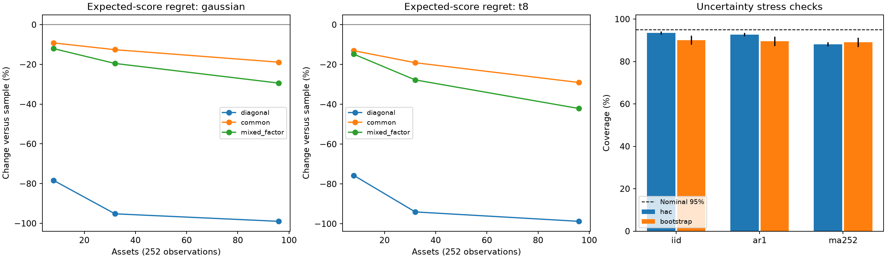

# Does correlation shrinkage improve risk forecasts?

## Simulations and a historical mixed-asset ETF case study

**Research report — 19 October 2026**

Protocol: `correlation-shrinkage-v1.0`, with operational amendment A1.

Status: completed covariance-forecast comparison; incomplete secondary portfolio analysis. No independent external scientific review is claimed.

## Abstract

Covariance estimates determine how a risk model represents diversification. Sampling noise in estimated correlations can distort both risk forecasts and portfolio decisions. This study compares a sample second-moment estimator with analytical correlation shrinkage that preserves each asset's estimated variance.

Controlled simulations cover three covariance structures, two return distributions and three dimensions. Shrinkage produces lower average expected matrix-score regret in all 18 fixed-covariance scenarios, with particularly large gains when the diagonal target is correct. In a historical case study of eight exchange-traded products, both estimators generate 4,780 next-session forecasts over 2007–2025 using 252 trailing daily returns. Shrinkage has lower observed mean forecast loss, but the primary nominal 95% interval for the paired difference is **[−0.6373, +0.3077]**. The bootstrap sensitivity interval also spans zero.

The historical evidence is therefore inconclusive under the prespecified procedures. Separate uncertainty diagnostics reveal undercoverage, and many portfolio optimizations fail the independent numerical acceptance checks. These findings limit the strength of inference and leave the portfolio extension incomplete. They are retained alongside the favourable simulation results.

## 1. Research question and economic motivation

The primary question is:

> Does shrinking estimated correlations towards zero improve next-session multivariate risk forecasts relative to the sample estimator?

An estimated covariance matrix combines individual variances with relationships between assets. Those relationships contain sampling error. A portfolio optimizer can amplify that error by assigning large weights to exposures that appear to diversify one another unusually well in the training sample.

Shrinkage reduces the magnitude of estimated correlations. This can reduce estimation variance, but it also introduces bias when true correlations are nonzero. Positive relationships describe shared exposure; negative relationships can describe useful hedges. Dampening either can worsen a decision. The hypothesis is consequently conditional on the estimator, target, sample size, return process and evaluation loss.

This study evaluates risk forecasting first. Minimum-variance target weights are a secondary application. It does not estimate expected returns or test an investment-alpha signal.

## 2. Estimators and forecast loss

Let X contain T=252 trailing return vectors for p assets. Both methods use a shared zero-conditional-mean approximation and the normalization:

\[
S_t=\frac{1}{T}X_t^\top X_t.
\]

Without the zero-mean approximation, this is a second moment rather than a demeaned covariance estimate. No sample mean is fitted or subtracted.

The baseline forecast is S. For the candidate, define the diagonal matrix D of sample standard deviations, standardized observations Z=XD⁻¹, and R=ZᵀZ/T. Apply the analytical Ledoit–Wolf intensity rule to Z with centering disabled, then rescale:

\[
\widehat\Sigma_t
=D_t[(1-\delta_t)R_t+\delta_t I]D_t
=(1-\delta_t)S_t+\delta_t\operatorname{diag}(S_t).
\]

The intensity is calculated from the current training window alone and clipped to [0,1] according to the frozen formula. The exact numerator, denominator and numerical branches are recorded in the [protocol](protocol/frozen/v1.0/PROTOCOL-DRAFT.md).

This construction preserves individual sample variances. It tests regularization of estimated dependence; it cannot improve marginal variance forecasts by changing those variances. It also differs from conventional Ledoit–Wolf shrinkage applied directly to raw returns, which usually targets a scaled identity matrix. The analytical rationale does not establish that this standardized, rescaled intensity is optimal for forecast loss or portfolio risk.

The primary score is matrix Gaussian quasi-likelihood:

\[
L(A_t,r_{t+1})
=\log\det(A_t)+r_{t+1}^{\top}A_t^{-1}r_{t+1}.
\]

The quadratic term penalizes underestimated risk in directions where returns move. The log-determinant term penalizes excessive overall dispersion. Under appropriate moment conditions, expected loss is minimized by the conditional second moment. Choosing this score does not assume that actual returns are Gaussian.

Define the paired difference as shrinkage loss minus sample loss. Negative values favour shrinkage. Absolute score levels depend on return units; percentage changes in these historical losses do not describe investment performance. Implementation uses Cholesky factorizations and linear solves, with no explicit matrix inversion, added ridge or eigenvalue repair.

## 3. Historical data and research controls

The fixed universe represents common allocation exposures:

| Product | Intended exposure |
|---|---|
| SPY | US large-cap equities |
| EFA | Developed large/mid-cap equities outside the US and Canada |
| EEM | Emerging-market large/mid-cap equities |
| IEF | US Treasuries with remaining maturities of 7–10 years |
| TLT | US Treasuries with remaining maturities above 20 years |
| LQD | USD investment-grade corporate bonds |
| GLD | Physical gold through a trust |
| VNQ | US listed real-estate equities |

These are eight products, not eight independent economic factors. Equity exposures overlap, corporate bonds carry both credit and interest-rate risk, and IEF/TLT deliberately share Treasury exposure at different maturities.

Official issuer pages and factsheets support product identities, inception before 2005 and the intended broad exposures. They also document changes: VNQ's benchmark transitioned during 2018, and GLD adopted a different gold-price reference in 2015. Complete historical benchmark genealogy is not established. The study treats these as product histories with evolving exposures, rather than constant-mandate factor series.

The accepted Yahoo snapshot contains **5,283 prices per asset**, covering every required XNYS session in 2005–2025. Simple returns use the provider's adjusted-close field, described by Yahoo as adjusted for splits and dividend and/or capital-gain distributions. The dataset has no missing required sessions, forward filling, pairwise deletion or outlier clipping. Two EEM moves above the diagnostic 20% threshold were consistent with the raw closing-price movements and retained.

Every forecast uses only the previous 252 return vectors and targets the next exchange session. Both methods use the same **4,780 targets, from 3 January 2007 to 31 December 2025**. Exchange-calendar alignment includes exceptional closures, not just weekends and routine holidays.

The methodological protocol was frozen locally before execution. An operational amendment permitted the synthetic work to proceed while issuer access was blocked; issuer/source acceptance preceded historical acquisition. Synthetic diagnostic weaknesses were known before the historical run, but the methods, window, assets, tolerances and inference settings were retained. Local hashes preserve version identities; they do not constitute external preregistration.

## 4. Controlled simulations

The fixed-covariance grid has 18 cells: dimensions 8, 32 and 96; three correlation structures; and Gaussian or covariance-scaled Student-t returns with eight degrees of freedom. Each cell has 500 independent training samples of length 252. Asset variances are heterogeneous.

The three structures are diagonal covariance, strong common correlation and mixed-sign two-factor dependence. They include a correctly specified diagonal target and cases where shrinkage dampens genuine relationships. No winning scenario is selected after execution.

Known population covariance permits direct measurement of matrix error and expected-score regret:

\[
\mathcal R(A,\Sigma)
=\log\det(A)-\log\det(\Sigma)
+\operatorname{tr}(A^{-1}\Sigma)-p.
\]

Unlike historical realized loss, this diagnostic averages out next-return noise using known truth. In the eight-asset Gaussian cases:

| Correlation structure | Sample regret | Shrinkage regret | Reduction in regret |
|---|---:|---:|---:|
| Diagonal | 0.14945 | 0.03231 | 78.4% |
| Strong common correlation | 0.15120 | 0.13728 | 9.2% |
| Mixed-sign factors | 0.15151 | 0.13323 | 12.1% |

Average expected-score regret is lower with shrinkage in **all 18 cells**, with all 9,000 matrix comparisons valid. The benefit is largest when the target is correct. Higher dimensions generally increase the benefit under these generators. These are simulation estimation results, not percentage reductions in historical portfolio risk.

Loss choice matters: covariance Frobenius error is slightly worse in two common-correlation Gaussian cells despite improved expected-score regret. Improvement on one matrix criterion does not imply dominance across criteria.

A separate adaptation challenge uses 400 paths, with 200 per return distribution. Each path has 1,260 targets and a covariance switch after target 630, including a 1.5-fold volatility increase. All **504,000 paired forecast targets** are valid. Mean expected-score regret favours shrinkage in the declared segment summaries; the transition segment overlaps the post-change segment and is not an independent discovery.

*Figure 1. The first two panels show changes in expected-score regret under known covariance. The third shows empirical coverage of nominal 95% intervals. Error bars in that panel are one Monte Carlo standard error. Full cell-level results, denominators and Monte Carlo uncertainty are retained in the [synthetic report](docs/results/synthetic/REPORT.md).*

## 5. Historical results and uncertainty

The primary estimand is the mean paired loss difference. The substantive improvement hypothesis is E[d]<0. The frozen decision rule requires the upper endpoint of the primary two-sided nominal 95% interval to be below zero.

The primary procedure is Newey–West HAC with a Bartlett kernel, lag 252 and normal critical value 1.959963984540054. The predefined sensitivity is a basic stationary-bootstrap interval using 4,999 replications, expected block length 252 and PCG64 seed 41002. It resamples stored paired losses, rather than refitting models to resampled market paths. Neither bandwidth nor block length was selected from historical outcomes.

| Historical quantity | Result |
|---|---:|
| Sample mean loss | −73.745933 |
| Shrinkage mean loss | −73.910693 |
| Mean paired difference | **−0.164760** |
| Primary nominal 95% HAC interval | **[−0.637263, +0.307743]** |
| Bootstrap nominal 95% sensitivity interval | **[−0.517470, +0.322224]** |
| Valid paired targets | **4,780 / 4,780** |

Shrinkage has lower observed average loss. Both intervals span zero, so the study does not satisfy its prespecified improvement rule. This is inconclusive evidence, not a demonstration that the estimators are equivalent.

Interval calibration is a separate concern. Before historical execution, known-mean diagnostics examined independent observations, AR(1) dependence and long overlapping MA(252) dependence:

| Diagnostic process | HAC coverage | Bootstrap coverage |
|---|---:|---:|
| Independent | 93.4% | 90.0% |
| AR(1) | 92.7% | 89.5% |
| MA(252) | **88.1%** | **89.0%** |

All intervals were nominally 95%. HAC coverage uses 1,000 replications per process; bootstrap coverage uses 200, with 999 resamples each. Monte Carlo standard errors and rejection directions appear in the detailed report. These diagnostics do not measure the exact coverage of the historical interval, but they provide evidence against treating the nominal level as reliable across dependence structures. Market regime changes add further uncertainty. The bootstrap does not provide independent replication or repair the primary procedure's weaknesses.

*Figure 2. The upper panel accumulates shrinkage-minus-sample forecast loss across all target sessions; it is not a portfolio equity curve. The lower panel shows maximum monthly target weights. Gaps retain failed numerical acceptance checks. The series are descriptive and do not define additional selected-period hypothesis tests.*

## 6. Portfolio diagnostics and numerical limits

The secondary optimization minimizes estimated variance with nonnegative weights summing to one. There are no expected-return forecasts, short positions, leverage or outcome-dependent weight caps. Equal-weight and inverse-volatility allocations provide context; inverse volatility is not generally risk parity.

SLSQP uses the frozen settings: objective scaled by matrix trace, equal-weight initialization, analytic gradient, `ftol=1e-12` and at most 2,000 iterations. Returned solutions must also pass independent feasibility and first-order optimality checks, including the declared 1e-7 KKT tolerance. A solver success message alone is insufficient.

The historical run attempts all 228 month-end origins. Sample weights pass in 148 months and shrinkage weights in 140; only **94/228 origins have an accepted pair**. Many numerical solutions terminate successfully while failing the stricter optimality criterion. Raw weights and residuals remain recorded, without clipping, substituted solvers or relaxed tolerances. Target changes do not bridge failed months.

The simulations reveal the same limitation. At least one estimated portfolio fails acceptance in 6,793/9,000 grid replications, and only 1,970 replications have a complete accepted oracle-risk comparison. Two diagonal eight-asset oracle configurations also fail. The adaptation challenge records 70,079 optimizer failure events. These failures leave covariance scoring intact but prevent a completed portfolio-risk comparison.

A comparison restricted to accepted portfolios can be selected by numerical behaviour. It cannot establish that shrinkage produces better portfolios. Concentration also need not indicate estimation failure: even an oracle minimum-variance objective can favour low-volatility bond exposures. No executable P&L, execution costs or realized trading turnover is evaluated here.

## 7. Interpretation and next research steps

The evidence supports a limited conclusion: under the specified simulation generators, correlation shrinkage improves average expected matrix-score regret. The historical point estimate favours shrinkage, but the registered uncertainty procedures leave the improvement question unresolved. Their calibration weaknesses further limit inference.

The historical universe has only eight assets for 252 training observations, a dimension/sample ratio of approximately 0.032. This is a modest estimation problem, and simulation benefits at higher dimensions cannot be transferred directly to it. Other limits include the current fixed-product selection, overlapping economic exposures, asynchronous underlying markets, changing mandates, a zero-mean approximation and revised vendor adjustments. The sample is familiar historical evidence; past-only estimation does not make the overall research process genuinely unseen.

The next version should first address numerical portfolio validation and uncertainty calibration. Any revised solver or inference design must preserve this run, disclose the known outcomes and receive a separate version identity. Reusing the same history cannot create a fresh holdout. Nonlinear eigenvalue shrinkage remains a possible separately specified extension, rather than an estimator added to rescue this result.

## 8. Reproducibility

The project retains raw local acquisition responses, the accepted calendar, protocol and code snapshots, dependency versions, seed mappings, paired ledgers, matrices, raw target weights, failure records and artifact hashes. No failed score dates were discarded. Raw vendor data are excluded from publication candidates; redistribution rights have not been established.

The pre-run implementation suite has **39 passing tests**. An implementation-level arithmetic and provenance audit recomputed all 4,780 historical forecasts using the reference shrinkage implementation and direct matrix solves, checked all 228 monthly origins, and verified 30 output-artifact and 14 input hashes. The maximum direct loss discrepancy was approximately 2.52×10⁻¹². Numerical agreement validates implementation arithmetic, not statistical assumptions or economic generality. These checks form part of the development workflow; they are not an independent external scientific review.

**Acknowledgment:** This project was developed with the help of AI assistance under the maintainer's direction.

## References and evidence

- Ledoit, O. and Wolf, M. (2004). *A well-conditioned estimator for large-dimensional covariance matrices*. Journal of Multivariate Analysis, 88, 365–411. [DOI](https://doi.org/10.1016/S0047-259X(03)00096-4).
- Newey, W. K. and West, K. D. (1987). *A simple, positive semi-definite, heteroskedasticity and autocorrelation consistent covariance matrix*. Econometrica, 55, 703–708. [DOI](https://doi.org/10.2307/1913610).
- Politis, D. N. and Romano, J. P. (1994). *The stationary bootstrap*. Journal of the American Statistical Association, 89, 1303–1313. [DOI](https://doi.org/10.1080/01621459.1994.10476870).
- [Frozen protocol and version identity](protocol/FREEZE-RECORD.md), [operational amendment](protocol/AMENDMENT-A1.md), and [issuer/source acceptance](protocol/verification/ISSUER-ACCEPTANCE-20261019.md).
- [Historical run report](docs/results/historical/REPORT.md), [historical audit](docs/results/historical/audit.json), [synthetic run report](docs/results/synthetic/REPORT.md), and [synthetic audit](docs/results/synthetic/audit.json).

The detailed manifests and review notes retain the blocked early launch and technical audit interruption. Neither changed the accepted scientific inputs or final methods. This report presents the preserved completed results and their limits.
